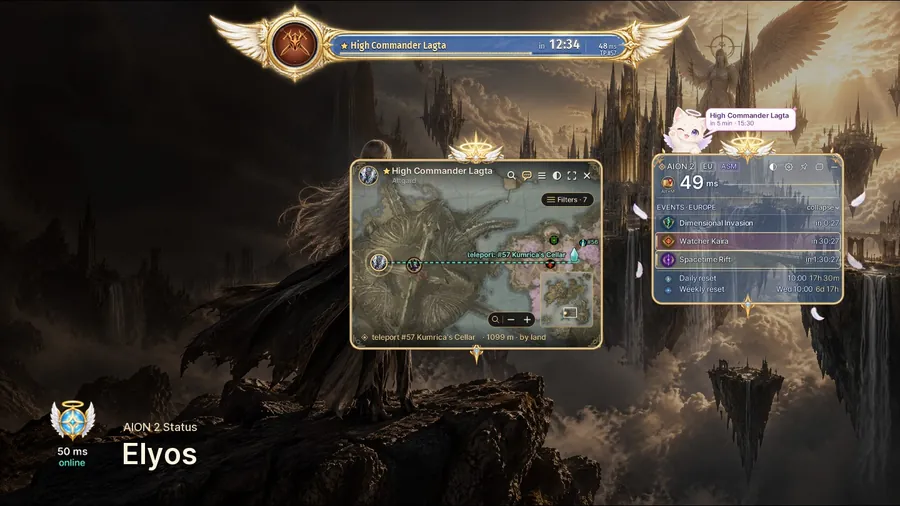
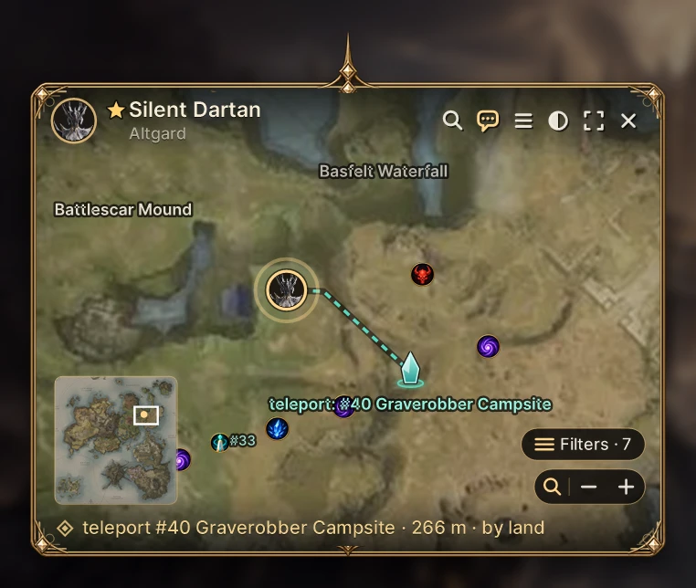

# Aion 2 Companion: Boss Timers, Map Routes & Server Status 🗺️

  

---

aion2-status is a free overlay for AION 2 that keeps the world's rhythm in view: live field boss timers, an interactive map that draws the route from the nearest teleport, Abyss bosses, rifts and invasions, plus server status and ping — all hovering quietly over the game window. It's built for players who'd rather read the world than fight the interface, with sound reminders and a chat-ready line whenever a boss is about to rise. Not a bot, not a cheat: it never touches the game process, its memory or its packets. The interface speaks English and Russian, and every piece of it is meant to be read, audited and tinkered with.

## Features

**Free**

- **Server pulse, live** — maintenance, booting up, open; your own ping to the server and back, plus how many AION 2 players are online through Steam. No more guessing whether the login queue is worth it.
- **Timers that actually tick** — field bosses fed by a live player feed, rifts, invasions, Kaira and Nahma, hourly events, daily and weekly resets. Everything on one clock, nothing buried in three menus.
- **Reminders your way** — a sound cue and a card (or a mascot sliding out of the frame) N minutes and 30 seconds before go-time. Set it, forget it, still make the pull.
- **Map on hover** — glide over a row and the map pops up beside the panel: where the boss stands, the nearest teleport, and the route from it — for both factions and the Abyss.
- **Chat-ready lines** — one copy gives you something like "Lagta in 12 min, TP #57" to paste straight into game chat yourself. Clean, short, no spam.
- **Three ways to wear it** — full main window, a compact in-game panel, or a single button; six styles to reskin the whole addon in one click.

**Premium** — from a single day up to twelve months, activated with an `A2-…` code that binds itself to your PC.

- **Top bar** — the next boss in large type above the game, blinking through the final 30 seconds, TP number and what comes next.
- **Map search in English and Russian** — bosses, teleports, gathering, cubes, traces; type it and jump to it.
- **Your own marks** — drop custom icons wherever you like, hit "route here", and layer in named monsters, dungeons, ore, gems, herbs and merchants.

Activate whenever you're ready: ⚙ Settings → Premium → **"Enter code or key…"**, paste, done — the key finds your machine on its own.

Built to feel like part of the game, not a second app fighting it for focus — and it stays a window, never a hand on the wheel.

## Installation

Getting **aion2-status** onto your machine is the easiest part of the whole adventure — no launchers to wrangle, no dependency chains, no arcane config files to hand-edit at midnight. Grab the release archive, unpack it wherever your heart (or your SSD) prefers, and double-click the executable. That's it. The overlay wakes up, asks which faction you're running with, and settles itself neatly on top of your game window.

If Windows greets you with that familiar blue SmartScreen whisper — the one that eyes every fresh executable with suspicion — just click through the "More info" path and let it run. Your addon is a standalone companion; it doesn't need to burrow into the game folder or ask for administrator blessings. Keep it in its own little corner of the drive and it'll be perfectly happy there.

One small ritual before you dive in: make sure AION 2 is running in **borderless windowed** mode. That's the stage the overlay performs on — fullscreen exclusive would shove it out of the spotlight. Flip that setting once and forget it.

On first launch the interface will mirror your Windows language, so English and Russian speakers land right at home. Prefer the other tongue? A quick hop into the settings panel switches it on the spot. And tucked inside the archive you'll find a short handwritten-style guide — alternative it open if you want the grand tour before your first boss timer starts ticking.

## Safety & Compatibility

Think of **aion2-status** as a friendly observer sitting on your second monitor, not a hand reaching into the game. It draws its own window on top of AION 2 and keeps a respectful distance from everything else — no injection into the game process, no peeking at memory, no sniffing packets, no pressing buttons on your behalf. It reads a single log line to know whether you're in the world, asks your system which server the game is talking to, and probes that server with an empty connection every so often. That's the whole trick.

**What it does**

- Draws a click-through-friendly overlay window above the game (borderless windowed mode recommended)
- Reads the last line of the game's breadcrumb log — read-only, just to confirm you're in the world
- Runs a quick system query to identify the server the game is connected to
- Opens one lightweight connection to the game server at a gentle interval to measure ping and status
- Registers hotkeys the ordinary way — no global keyboard or mouse hooks
- Pulls public schedule data to keep boss timers, Abyss spawns and event windows in sync

**What it never does**

- Inject into AION 2, read or write its memory, or touch its files
- Modify anything the game's protection layer cares about
- Send keystrokes, clicks or macros into the game
- Install global input hooks or background services
- Collect telemetry or ship data about you anywhere
- Demand administrator rights — it runs as a plain, unprivileged user

**Compatibility notes**

- **Windows 10 / 11**, 64-bit — the overlay is happiest in borderless windowed mode, where it can float cleanly above the action
- **AION 2 Global / EU (Steam)** — both factions, all the usual servers; the interface speaks English and Russian and follows your Windows language by default
- **Multi-monitor and DPI scaling** — the window respects your desktop layout, so it lands where you expect it to
- **VPNs and tunnels** — ping measurement adapts when your traffic routes through a TUN-style tunnel, so numbers stay meaningful
- **No conflict with the game client** — the overlay never grabs focus, never steals your keyboard, and can be pinned click-through when you want it out of the way

If you like to know exactly what touches your machine, the source code is open for the parts that matter — the network layer, the ping logic, the game-detection and focus handling, the overlay window, and the update verifier. Read them, audit them, nod approvingly. The rest stays wrapped up so the addon doesn't sprout unauthorized clones.

One last thing, and it's the important one: **aion2-status is not a bot and not a cheat.** It's a fan-made companion that respects the game, the client, and you. Use it to plan your boss runs and teleport routes, not to skip the adventure.

## 📸 Screenshot

## Gallery

Everything in this addon is meant to be *seen* — and immediately understood. No buried menus, no tab-hunting mid-fight. Here's what it looks like when AION2 Status is doing its thing over the game window.

**Six faces of the same overlay.** Six styles — Classic, Ethereal, Anime, Elyos, Asmodians and Sakura — reskin the entire addon in one click: the top bar, the in-game panel, the map window and the Micro button all shift together. You pick one on first launch, and you can swap any time under ⚙ Settings → Style. Abyss rows — Kaira, Nahma, siege bosses, Argo — get their own crimson-violet band so they never blend into the field-boss rows.

**The mascot that taps you on the shoulder.** Flag a boss with the 🔔 and, moments before spawn, the style's mascot slides out of the frame with a tiny bubble — "Argo in 5 min · 15:30" — then quietly tucks itself away. A white kitten with a crown, a cream one with a halo, a black one with a crescent, or a little fox with a sakura flower. No full-screen pop-ups interrupting your rotation.

**The top bar, hovering above the world.** Your next boss in large type, blinking through the final 30 seconds, with the teleport number and a hint at what follows. Glance up, know exactly where to be.

**The map that answers "how do I get there?"** Hover a timer row and a compact map blooms beside the panel: the boss's location, the nearest teleport, and the route from it — drawn for both factions and the Abyss. Click through and the full map opens with filters, EN/RU search and your own custom marks with icons and "route here."

**Everything else at a glance.** Server status and ping sitting quietly in the corner. Sound reminders and reminder cards. Chat-ready lines you paste yourself. A compact in-game panel or a single Micro button when you want the overlay to almost disappear. Every screenshot here is the real thing — no mockups, no marketing gloss. Just the addon, on top of the game, exactly as it ships.

## Credits & License

This addon exists because a handful of people kept dying to the same field boss and decided to fix it with code instead of complaints. The **AION2 Status** team is a small crew of modders, map nerds and timer-obsessed players who believe an overlay should feel like a well-worn tool belt — not a second job. From the live player feed that keeps boss timers honest, to the hand-drawn teleport routes layered over the interactive map, every feature started as someone's "wouldn't it be nice if…" in a Discord thread at 2 AM. Abyss boss coverage, server ping, alternative-of-dawn maintenance alerts — all of it was stress-tested on real sieges, real resets and real "wait, was that Kaira or Nahma?" moments. We ship what we play with.

**License & the spirit of the thing**

AION2 Status is a **fan project**, freely shared with the AION 2 modding community, and proudly **not affiliated with NCSOFT** — AION and all related names are trademarks of NCSOFT Corporation. The addon itself is meant to be **used, tinkered with and learned from**, not resold or rebranded. Portions of the source are kept open precisely so curious modders can audit how the overlay talks to the network and the game — study it, fork ideas from it, improve it. What we ask in return is simple: keep the credits intact, don't repackage the work under a new name, and don't strip the safety checks that keep the overlay harmless.

- **Personal & community use** — free to run on your own machine, free to recommend to your guild, free to mention in a community post or wiki.
- **Modding & contributions** — pull requests, translated strings, corrected boss routes and cleaner map data are all welcome. If you fix a timer or sharpen a teleport path, your name goes in the credits.
- **No re-uploading** — don't host the build elsewhere, don't sell it, don't bundle it with bots, macros or anything that touches the game process. That's not what we made.
- **No warranty** — the overlay is provided as-is, for the love of the game. Bosses bug out, servers go down, timers drift. We'll fix what we can, but you run it at your own risk.
- **Asset credits** — map layer data, icon sets and style themes were assembled from community contributions and public feeds; if you recognize your work here and want a name added, reach out and we'll make it right.

**AION2 Status** is built by players, for players. Not a bot, not a cheat — just a cleaner way to see the game. Fly safe, watch your cooldowns, and may your teleport always be the nearest one.

